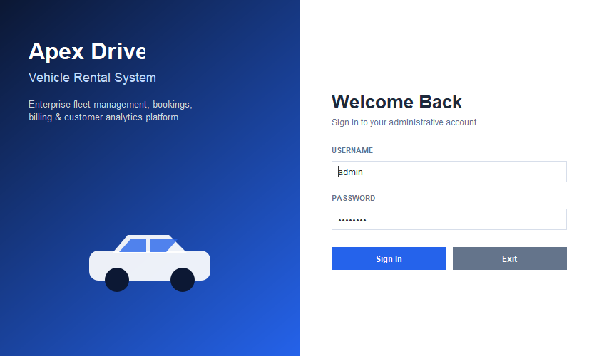
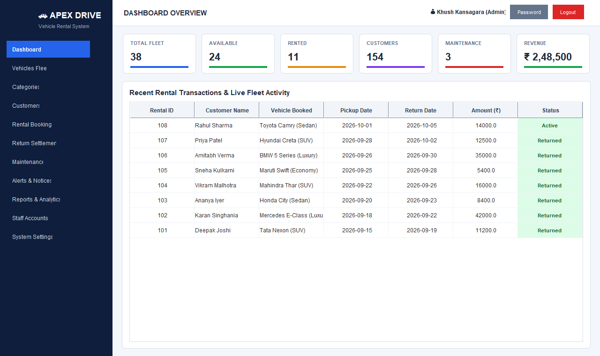
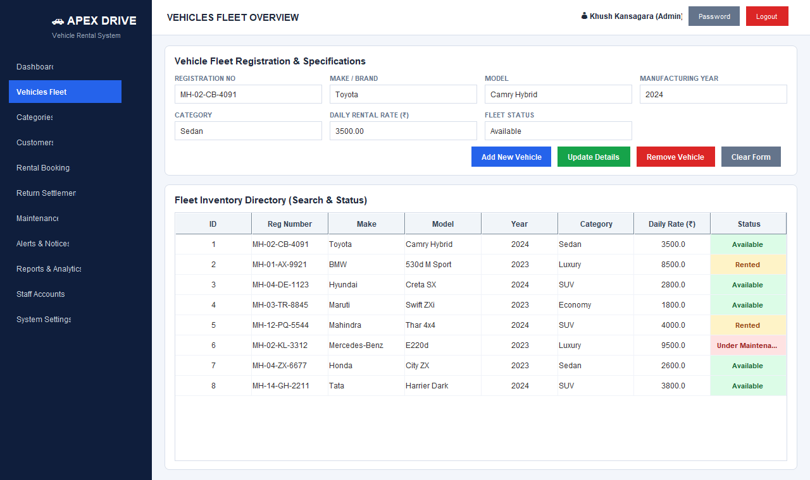
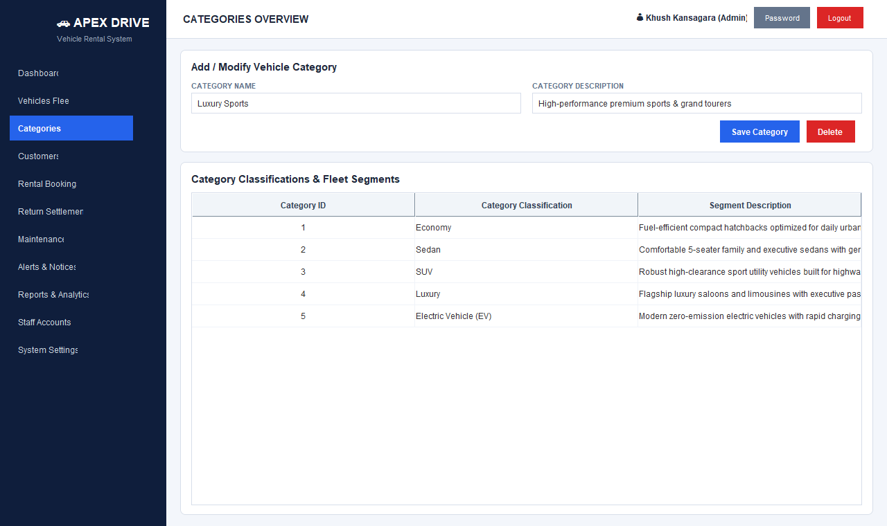
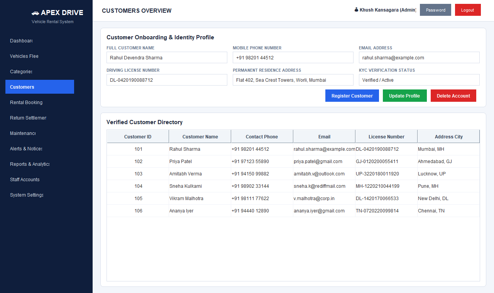
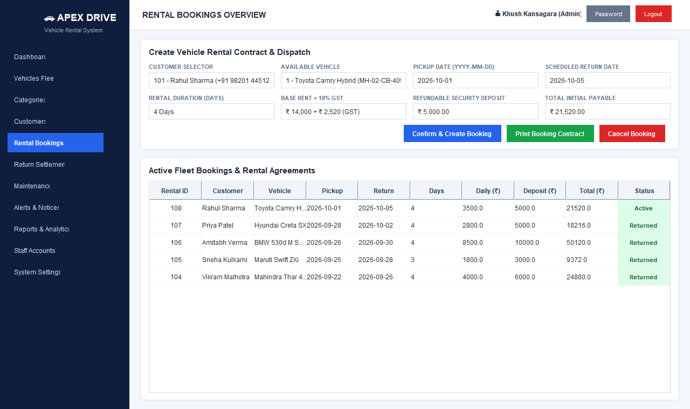
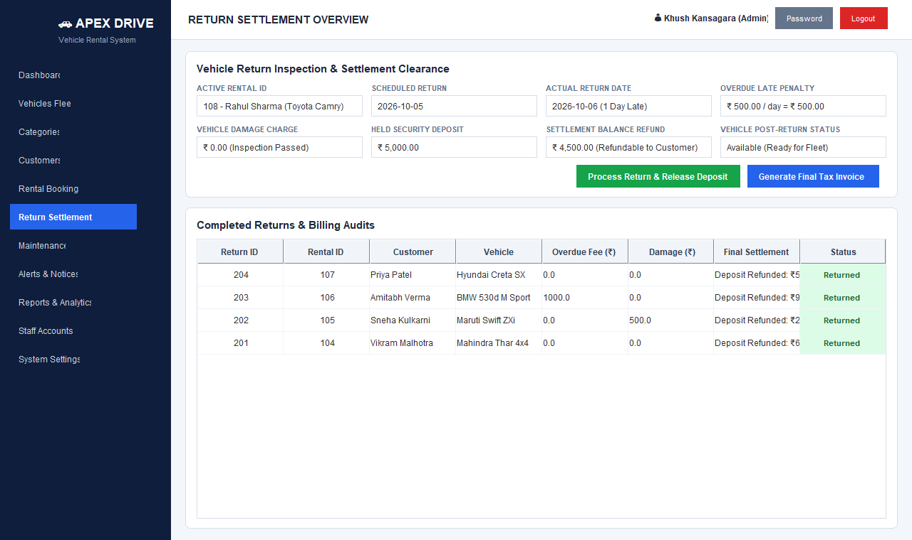
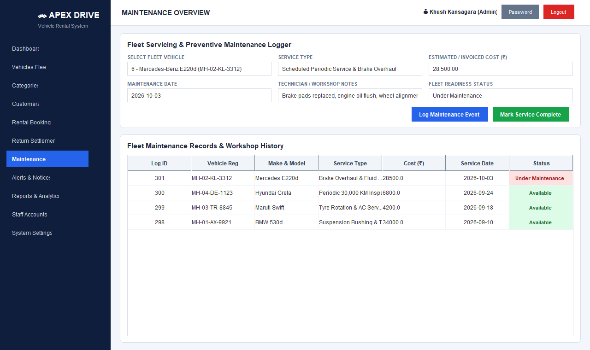
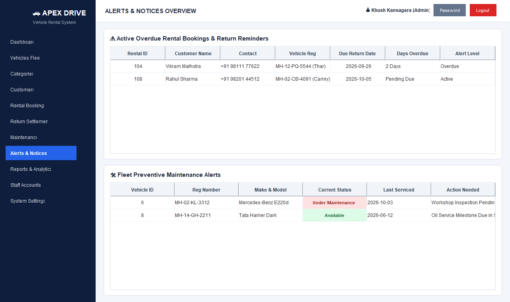
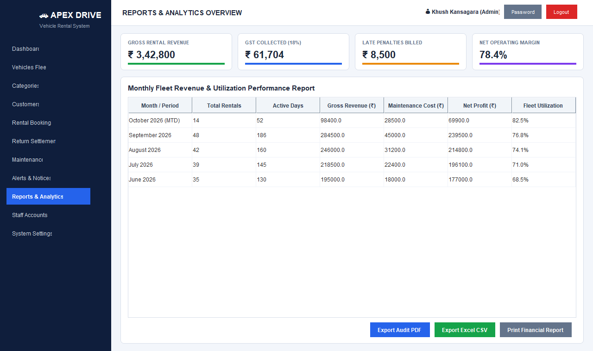

# 🚗 Vehicle Rental Management System

A desktop fleet & vehicle rental management system developed in **Java Swing** with **MySQL** database persistence and modern UI design.

---

## 👥 Contributors & Roles

| Contributor | GitHub Profile | Role | Responsibilities |
| :--- | :--- | :--- | :--- |
| **Khush Kansagara** | [@thekhushhub](https://github.com/thekhushhub) | **Backend Developer** | Database Schema, JDBC Connectivity, Business Logic, Rental Calculations, Penalties, Staff & System Settings |
| **Dev** | [@DEV2007746](https://github.com/DEV2007746) | **Frontend Developer** | Swing UI Layouts, Design System, Custom Renderers, Navigation, Forms, Modals & Branded Artwork |

---

## 📊 Project Presentation (PPTX)

An editable presentation showcasing the system architecture, development methodology, and module walkthroughs is included:
- 📥 **[Download Editable PowerPoint Presentation (PPTX)](Vehicle_Rental_Management_System_Presentation.pptx)**

---

## 📸 Application Screenshots & Modules

### 1. Dual-Pane Login & Authentication


### 2. Executive Operations Dashboard


### 3. Vehicle Fleet Inventory Management


### 4. Vehicle Category Classification


### 5. Customer Directory & KYC Records


### 6. Rental Booking & Dispatch Engine


### 7. Return Inspection & Settlement Clearance


### 8. Fleet Maintenance & Service Log


### 9. Real-Time System Alerts & Notices


### 10. Financial Performance & Utilization Analytics


---

## ✨ Features

- **🔐 Role-Based Access Control:** Dual-tier user access for `Admin` and `Staff` with secure credential verification.
- **📊 Real-Time Operations Dashboard:** Live KPI stat cards (Total Fleet, Available, Rented, Maintenance, Total Revenue) and recent transactions table.
- **🚘 Fleet Management:** Comprehensive CRUD operations, status management (`Available`, `Rented`, `Under Maintenance`), and category filtering.
- **🏷️ Vehicle Categorization:** Classification by vehicle segment (Economy, Sedan, SUV, Luxury, EV).
- **👤 Customer Profiles:** Customer directory with driver license verification and contact records.
- **📝 Rental Bookings Engine:** Automated duration computation, daily rates, security deposits, GST/tax calculations, and booking workflows.
- **🔄 Returns & Settlement:** Return processing, late fee penalties, damage assessments, and final bill generation.
- **🛠️ Fleet Maintenance:** Service log tracking, repair cost monitoring, and automated status synchronization.
- **🔔 System Alerts:** Active tracking for overdue rental returns and pending vehicle service.
- **⚙️ Business Settings:** Configurable company branding, GST rates, and penalty fees.

---

## 🛠️ Technology Stack

- **Language:** Java (JDK 17+)
- **GUI Framework:** Java Swing with custom 2D vector styling (`Graphics2D`, anti-aliased components)
- **Database:** MySQL Server 8.0+ / MariaDB (via XAMPP)
- **Connector:** MySQL Connector/J (`mysql-connector-j-26.7.0.jar`)
- **IDE Support:** VS Code, IntelliJ IDEA, Eclipse, NetBeans

---

## 🚀 Getting Started

### 1. Database Setup
1. Launch MySQL via **XAMPP Control Panel** or your local MySQL server.
2. Import the database schema:
   ```bash
   mysql -u root -p < schema.sql
   ```
   *(Or copy-paste the contents of `schema.sql` into phpMyAdmin).*

### 2. Compile & Run

#### Using PowerShell / Terminal:
```bash
# Compile
javac -cp "mysql-connector-j-26.7.0.jar" VehicleRentalApp.java

# Run
java -cp ".;mysql-connector-j-26.7.0.jar" VehicleRentalApp
```

### 3. Default Credentials
- **Username:** `admin`
- **Password:** `admin123`
